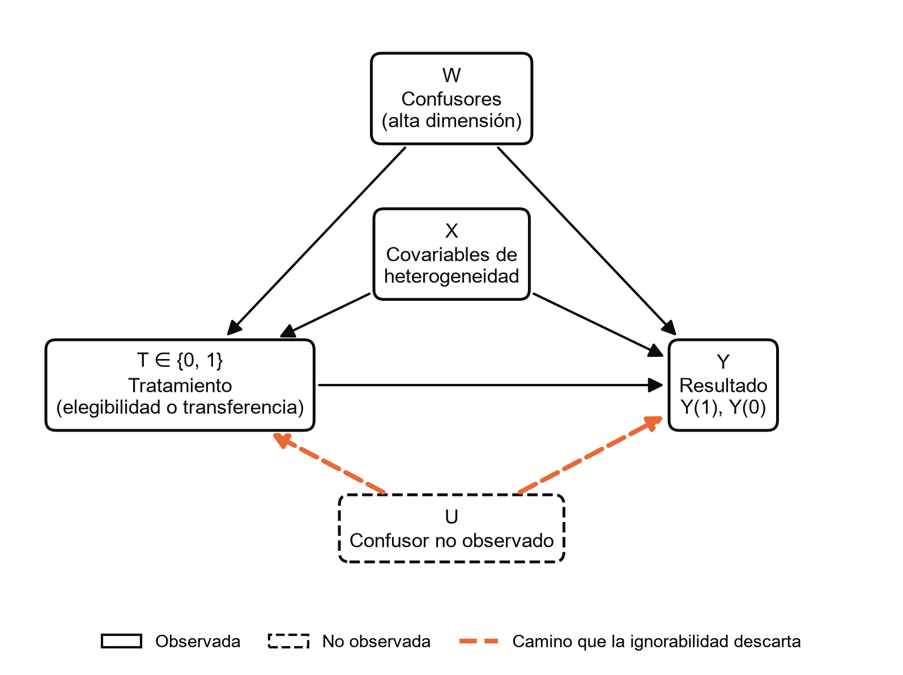
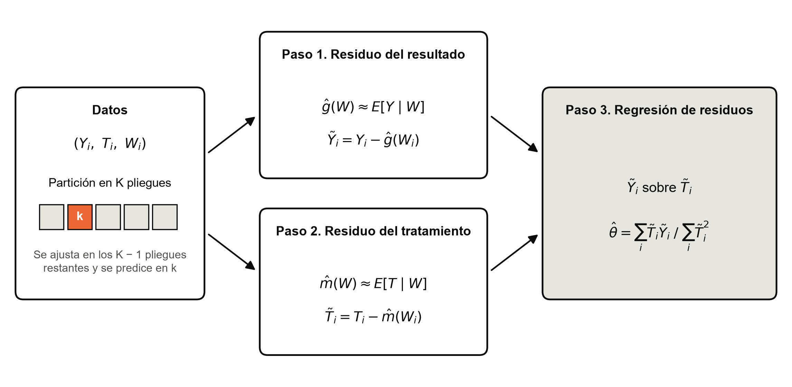
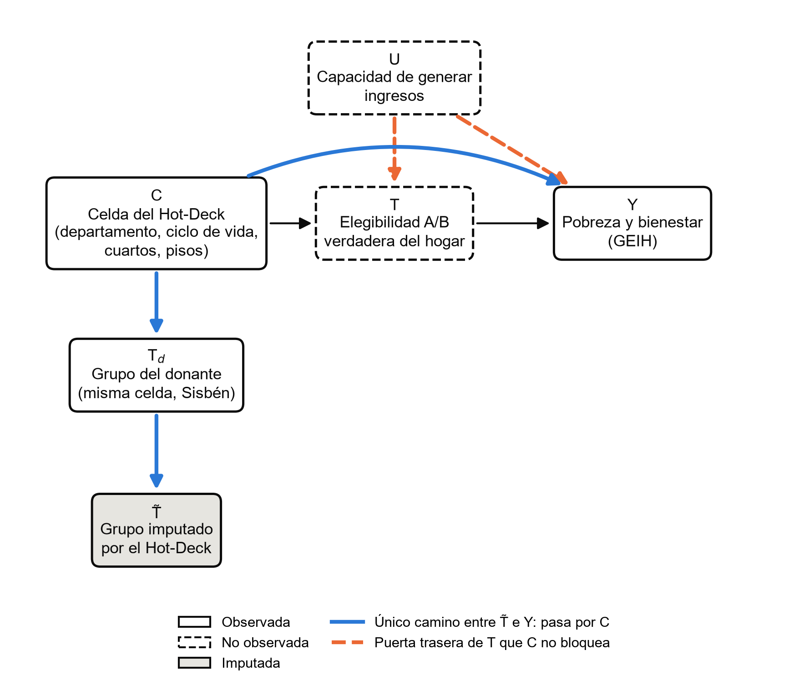
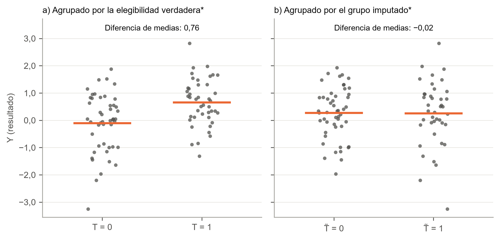

# Figuras del marco teórico y de la metodología (formato APA 7)

Figuras para pegar en el documento, a 300 dpi y sin título dentro de la
imagen, como pide APA: el número y el título van encima de la figura y la
nota debajo. Se regeneran con `python -m src.utils.figuras_tesis`. Antes de
guardar cada DAG, el código comprueba con d-separación lo que afirma su
nota.

| Figura | Dónde va | Imagen |
|---|---|---|
| Figura 1 | Sección 2.2, después del párrafo que define la ignorabilidad condicional y el solapamiento | [`fig_dag_ignorabilidad_marco.png`](figuras/fig_dag_ignorabilidad_marco.png) |
| Figura 2 | Sección 2.2, junto al párrafo del DML (comentario del director: «una figura con los tres pasos ayuda más que este párrafo») | [`fig_dml_tres_pasos.png`](figuras/fig_dml_tres_pasos.png) |
| Figura N | Metodología, junto a la Proposición 1 (el párrafo de la «propiedad de independencia condicional») | [`fig_dag_ignorabilidad_hotdeck.png`](figuras/fig_dag_ignorabilidad_hotdeck.png) |
| Figura N + 1 | Inmediatamente después, la ilustración que dibujó el director (las dos nubes de la celda) | [`fig_nubes_celda_placebo.png`](figuras/fig_nubes_celda_placebo.png) |

La Figura 1 usa la notación de la sección 2.2 (T, Y, X, W) y no menciona
el enlace. Las dos de la metodología usan su notación (C, T, T̃, Y); el número se
ajusta al orden del documento.

---

**Figura 1**

*Grafo acíclico dirigido de la ignorabilidad condicional*

*Nota.* T es el tratamiento (elegibilidad o transferencia), Y el
resultado, W los confusores y X las covariables con las que se estudia la
heterogeneidad del efecto. Condicionar en X y W bloquea todos los caminos
de puerta trasera entre T e Y, y la ignorabilidad condicional
(Y(1), Y(0) ⫫ T | X, W) se cumple. Un confusor no observado U abre el
camino T ← U → Y (en naranja), que ninguna variable observada bloquea; el
supuesto equivale a afirmar que ese camino no existe (Pearl, 2009).
Elaboración propia.

---

**Figura 2**

*Pasos del estimador Double/Debiased Machine Learning en el modelo parcialmente lineal*

*Nota.* Las funciones de molestia ĝ y m̂ se estiman con algoritmos
flexibles (por ejemplo, Gradient Boosting o Random Forest) en K − 1
pliegues y se evalúan en el pliegue restante k; el proceso rota por los K
pliegues, de modo que ningún residuo se calcula con un modelo entrenado
con la misma observación. θ̂ es la pendiente de la regresión de Ỹ sobre T̃
y es √n-consistente aunque ĝ y m̂ converjan más lento. Elaboración propia
con base en Chernozhukov et al. (2018).

---

**Figura N**

*Grafo acíclico dirigido de la Proposición 1: independencia condicional del grupo imputado*

*Nota.* C es la celda del Hot-Deck (departamento, ciclo de vida del jefe,
cuartos y material de los pisos), U la capacidad no observada de generar
ingresos, T la elegibilidad A/B verdadera del hogar (no observada en la
GEIH), Td el grupo del donante sorteado en la misma celda del
Sisbén IV y T̃ el grupo que el Hot-Deck imputa al hogar de la GEIH. El
único camino entre T̃ e Y pasa por C (en azul), de modo que, dada la celda,
T̃ ⫫ Y | C: una estimación con T̃ es un placebo del emparejamiento. La
elegibilidad verdadera, en cambio, conserva la puerta trasera T ← U → Y
(en naranja), que C no bloquea (Pearl, 2009). Elaboración propia.

---

**Figura N + 1**

*Resultado de los hogares de una celda según la elegibilidad verdadera y según el grupo imputado*

*Nota.* Datos simulados (\*): 90 hogares de una misma celda, con un efecto
verdadero de 0,8 sobre Y y ruido normal estándar. Los dos paneles muestran
los mismos hogares; las líneas son las medias de cada grupo. Agrupados por
la elegibilidad verdadera (panel a), las nubes se separan en el efecto;
agrupados por el grupo imputado (panel b), que se sortea en la celda sin
mirar Y, las dos nubes son iguales y la diferencia es cero, sea cual sea
el efecto verdadero. Elaboración propia; la comprobación con 200 sorteos
está en el anexo de proposiciones.

---

## Referencias que citan las notas

Pearl, J. (2009). *Causality: Models, reasoning, and inference* (2.ª ed.).
Cambridge University Press. https://doi.org/10.1017/CBO9780511803161

Si el documento define la ignorabilidad condicional citando a Rosenbaum y
Rubin, la referencia es:

Rosenbaum, P. R. y Rubin, D. B. (1983). The central role of the propensity
score in observational studies for causal effects. *Biometrika, 70*(1),
41-55. https://doi.org/10.1093/biomet/70.1.41

Ninguna de las dos está todavía en
[`BIBLIOGRAFIA_VERIFICADA.md`](BIBLIOGRAFIA_VERIFICADA.md): si se usan,
verificarlas y agregarlas allí y a la lista de referencias del documento.
