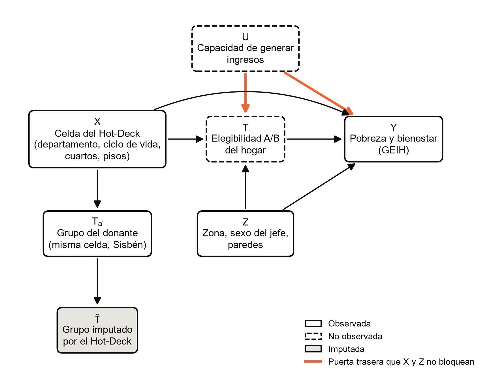

# Figura del DAG de ignorabilidad condicional (formato APA 7)

Para pegar en el documento. La imagen es
[`figuras/fig_dag_ignorabilidad.png`](figuras/fig_dag_ignorabilidad.png)
(300 dpi, sin título dentro de la imagen, como pide APA). Se regenera con
`python -m src.utils.figuras_tesis`, y antes de guardarla el código
comprueba con d-separación las dos afirmaciones de la nota. El número de
la figura se ajusta al orden del documento.

---

**Figura N**

*Grafo acíclico dirigido de la ignorabilidad condicional en el enlace por celdas entre la GEIH y el Sisbén IV*

*Nota.* X es la celda del Hot-Deck (departamento, ciclo de vida del jefe,
cuartos y material de los pisos), Z son las características que modifican
el efecto sin entrar en la celda, U es la capacidad no observada de
generar ingresos, T es la elegibilidad A/B del propio hogar (no observada
en la GEIH), Td es el grupo del donante sorteado en la misma
celda del Sisbén IV y T̃ es el grupo que el Hot-Deck imputa al hogar de la
GEIH. Dada X, el grupo imputado es independiente del resultado
(T̃ ⫫ Y | X), por lo que una estimación con T̃ funciona como placebo del
emparejamiento y no como efecto del Sisbén. En cambio, la ignorabilidad
condicional de la elegibilidad real, Y(t) ⫫ T | X, Z, no se cumple: el
camino T ← U → Y (en naranja) no se bloquea con variables observadas
(criterio de la puerta trasera; Pearl, 2009). Elaboración propia con base
en la GEIH 2024 (DANE) y el Sisbén IV (DNP).

---

## Referencias que cita la nota

Pearl, J. (2009). *Causality: Models, reasoning, and inference* (2.ª ed.).
Cambridge University Press. https://doi.org/10.1017/CBO9780511803161

Si el documento define la ignorabilidad condicional citando a Rosenbaum y
Rubin, la referencia es:

Rosenbaum, P. R. y Rubin, D. B. (1983). The central role of the propensity
score in observational studies for causal effects. *Biometrika, 70*(1),
41-55. https://doi.org/10.1093/biomet/70.1.41

Ninguna de las dos está todavía en
[`BIBLIOGRAFIA_VERIFICADA.md`](BIBLIOGRAFIA_VERIFICADA.md): si se usan,
verificarlas y agregarlas allí y a la lista de referencias del documento.
