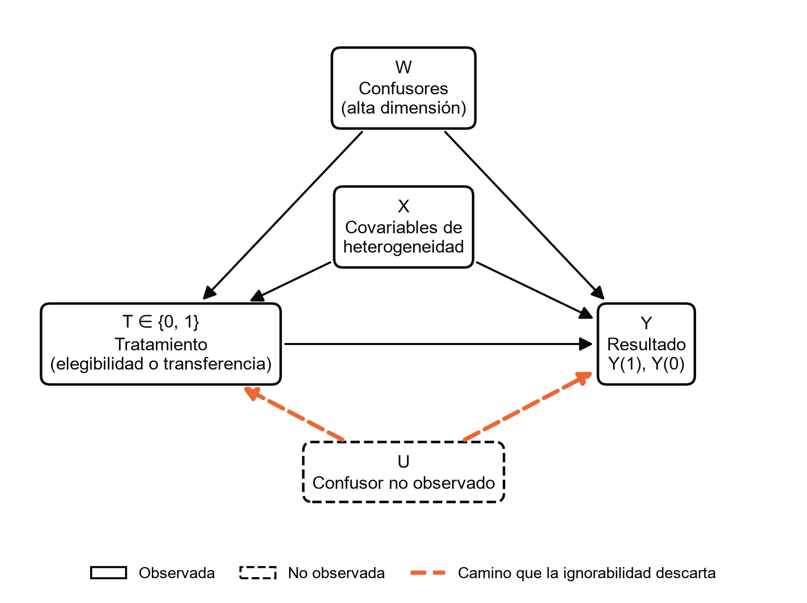
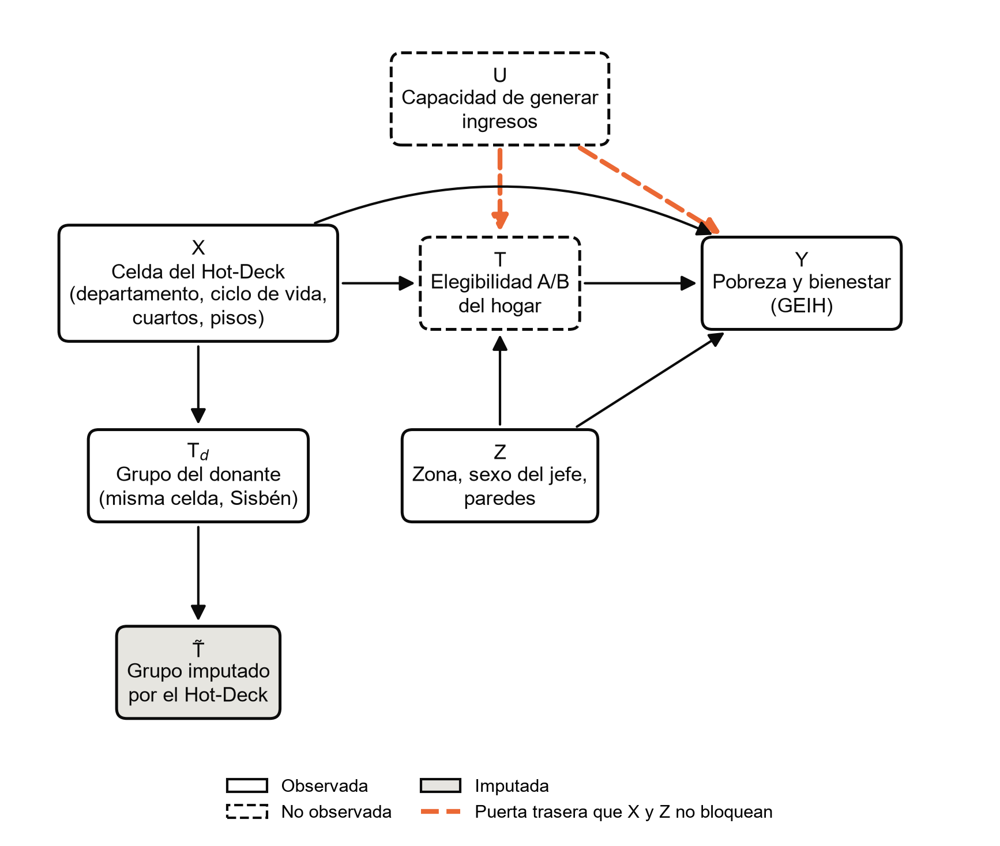

# Figuras de la ignorabilidad condicional (formato APA 7)

Dos DAG para pegar en el documento, a 300 dpi y sin título dentro de la
imagen, como pide APA: el número y el título van encima de la figura y la
nota debajo. Se regeneran con `python -m src.utils.figuras_tesis`. Antes de
guardar cada figura, el código comprueba con d-separación lo que afirma su
nota.

| Figura | Dónde va | Imagen |
|---|---|---|
| Figura 1 | Sección 2.2, después del párrafo que define la ignorabilidad condicional y el solapamiento | [`fig_dag_ignorabilidad_marco.png`](figuras/fig_dag_ignorabilidad_marco.png) |
| Figura N | Metodología, donde se explica el Hot-Deck o el placebo del DML | [`fig_dag_ignorabilidad_hotdeck.png`](figuras/fig_dag_ignorabilidad_hotdeck.png) |

La Figura 1 usa la notación de la sección 2.2 (T, Y, X, W) y no menciona
el enlace. La segunda aplica el mismo supuesto al enlace por celdas; el
número se ajusta al orden del documento.

---

**Figura 1**

*Grafo acíclico dirigido de la ignorabilidad condicional*

*Nota.* T es el tratamiento (elegibilidad o transferencia), Y el
resultado, W los confusores y X las covariables con las que se estudia la
heterogeneidad del efecto. Condicionar en X y W bloquea todos los caminos
de puerta trasera entre T e Y, y la ignorabilidad condicional
(Y(1), Y(0) ⫫ T | X, W) se cumple. Un confusor no observado U abre el
camino T ← U → Y (en naranja), que ninguna variable observada bloquea; el
supuesto equivale a afirmar que ese camino no existe (Pearl, 2009).
Elaboración propia.

---

**Figura N**

*Grafo acíclico dirigido de la ignorabilidad condicional en el enlace por celdas entre la GEIH y el Sisbén IV*

*Nota.* X es la celda del Hot-Deck (departamento, ciclo de vida del jefe,
cuartos y material de los pisos), Z son las características que modifican
el efecto sin entrar en la celda, U es la capacidad no observada de
generar ingresos, T es la elegibilidad A/B del propio hogar (no observada
en la GEIH), Td es el grupo del donante sorteado en la misma
celda del Sisbén IV y T̃ es el grupo que el Hot-Deck imputa al hogar de la
GEIH. Dada X, el grupo imputado es independiente del resultado
(T̃ ⫫ Y | X), por lo que una estimación con T̃ funciona como placebo del
emparejamiento y no como efecto del Sisbén. En cambio, la ignorabilidad
condicional de la elegibilidad real, Y(t) ⫫ T | X, Z, no se cumple: el
camino T ← U → Y (en naranja) no se bloquea con variables observadas
(criterio de la puerta trasera; Pearl, 2009). Elaboración propia con base
en la GEIH 2024 (DANE) y el Sisbén IV (DNP).

---

## Referencias que citan las notas

Pearl, J. (2009). *Causality: Models, reasoning, and inference* (2.ª ed.).
Cambridge University Press. https://doi.org/10.1017/CBO9780511803161

Si el documento define la ignorabilidad condicional citando a Rosenbaum y
Rubin, la referencia es:

Rosenbaum, P. R. y Rubin, D. B. (1983). The central role of the propensity
score in observational studies for causal effects. *Biometrika, 70*(1),
41-55. https://doi.org/10.1093/biomet/70.1.41

Ninguna de las dos está todavía en
[`BIBLIOGRAFIA_VERIFICADA.md`](BIBLIOGRAFIA_VERIFICADA.md): si se usan,
verificarlas y agregarlas allí y a la lista de referencias del documento.
