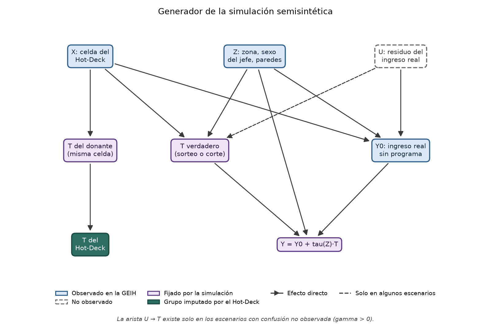
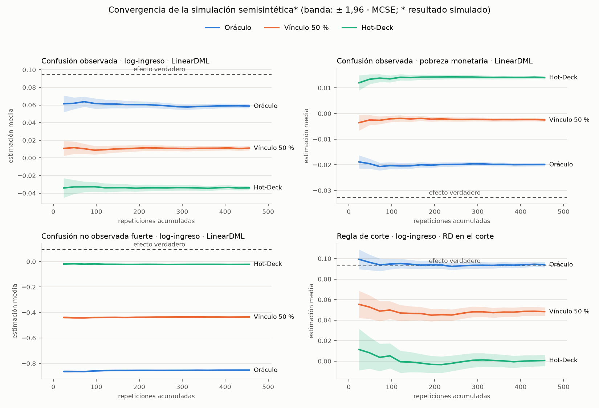

# Evaluación semisintética: recuperación de un efecto conocido sobre hogares reales

Generado por `src/simulacion/` (`docs/metodologia/DISENO_MODULO_SIMULACION.md`).
Corrida vigente: 2026-11-15, con la celda del Hot-Deck que suma personas
y menores de 18 años (3.721 celdas) y su cadena de respaldos.
Todas las cifras de esta página son simuladas (\*), salvo los datos reales que
alimentan el generador.
**456 repeticiones hasta la convergencia** (Causal Forest en 216), encuesta
de 30.000 hogares por repetición. Salidas en `docs/reports/`:
`simulacion_semisintetica.txt` (consola), `_resumen.csv` (métricas con su
error Monte Carlo), `_convergencia.csv` (traza por lote), `_tablas.md` (las
tablas de abajo, generadas del resumen) y `simulacion_semisintetica.csv`
(cada repetición). Figura: `simulacion_semisintetica_convergencia.png`.

Es el componente central que pidió el tutor (2026-10-27) y que detalla la
revisión externa (§9). A diferencia de `SIMULACION_IDENTIFICACION.md`
(mundo 100 % sintético), **las covariables, la celda del Hot-Deck, el
ingreso y la línea de pobreza son los de los 290.968 hogares reales de
GEIH 2024**; solo se simulan el tratamiento y el efecto, así que la verdad
se conoce hogar por hogar.

## Diseño

```text
DATOS REALES     celda del Hot-Deck (3.721), X = {zona, sexo del jefe, paredes},
                 Y0 = log(1 + ingreso per cápita de la UG), línea de pobreza del dominio
GENERADOR        U = parte del ingreso que la celda y X no explican (real, no observable)
                 score = logit P_Sisbén(T | celda) + X·b + gamma·U
                 T ~ Bernoulli(score); en la regla de corte, T = 1(puntaje ≥ corte),
                 puntaje = score + ruido de medición
                 tau(X) = 0,10 + 0,05·rural − 0,03·jefa + 0,04·paredes precarias
                 Y = Y0 + tau(X)·T
OUTCOMES         log-ingreso (efecto +0,095) y pobreza monetaria (efecto −0,033)
ESCENARIOS       aleatoria / confusión observada / efecto nulo / confusión no
                 observada leve, media y fuerte (gamma 0,25, 0,5, 1) / solapamiento
                 débil (score × 4) / regla de corte (con gamma = 1)
INTEGRACIÓN      oráculo (T verdadero) / vínculo 50 % (la mitad recibe T y puntaje
                 de un donante) / Hot-Deck (todos, de un donante de su celda)
ESTIMADORES      diferencia de medias, regresión con efectos fijos de celda,
                 LinearDML y CausalForestDML (los de 5_estimacion.py, W = celda),
                 RD local lineal en el corte (solo en la regla de corte)
EVALUACIÓN       sesgo, RMSE, cobertura del IC 95 %, ancho, PEHE (error del CATE),
                 degradación por integración, y el MCSE de cada una
```

- P(T | celda) sale del Sisbén real; la tasa de tratados es la misma en
  todos los escenarios (46,7 %, calibrada).
- En cada repetición la población se parte en dos muestras **sin llave
  común**: la "encuesta" (X, Y) y el "registro" (X, T, puntaje), como GEIH
  y Sisbén. **El T verdadero de la encuesta solo se usa para medir.**
- La pobreza es 1 si el ingreso queda bajo la línea del dominio (DANE
  2024). Su efecto verdadero es la diferencia, hogar por hogar, entre ser
  pobre con y sin tratamiento: −0,033 (3,3 puntos menos de pobreza).
- La RD estima el efecto **en el corte**: su objetivo es el efecto medio
  de los hogares cercanos al corte (+0,093 en log-ingreso, −0,037 en
  pobreza), no el ATE.
- Para usarla con otra fuente (registros administrativos de una entidad)
  basta una tabla con las columnas canónicas que exige
  `src/simulacion/contrato.py`.

**Papel de cada variable** (en el DAG del generador, `dag_simulacion.png`;
chequeos formales en `IDENTIFICACION_CAUSAL.md` §4):



| Variable | Papel | Dónde entra |
|---|---|---|
| Celda del Hot-Deck (departamento, edad del jefe, cuartos, pisos, personas, menores) | Confusora observada y estrato del emparejamiento | Asignación (P(T \| celda) del Sisbén real) y `W` de los estimadores |
| Zona, sexo del jefe, paredes | Confusoras observadas y modificadoras del efecto | Asignación (X·b), efecto tau(X) y `X` de los estimadores |
| U (residuo del ingreso real) | Confusora no observada | Solo la asignación, con fuerza gamma; ningún estimador la ve |
| Puntaje con ruido y corte | Regla de asignación | Solo en la regla de corte; variable de la RD |
| Y0 (log-ingreso real) y línea de pobreza | Resultado sin tratamiento | Outcome; nunca entra como covariable |

Que zona, sexo del jefe y paredes modifiquen el efecto es una decisión del
diseño, no un hallazgo: la simulación comprueba si un estimador recupera una
estructura conocida, no qué variables modifican el efecto de una
transferencia real. Con una heterogeneidad más amplia o más compleja, ver
`RESULTADOS_HETEROGENEIDAD_AMPLIADA.md`.

## Convergencia ("saciedad")

Las repeticiones corren en lotes de 24, en paralelo, hasta que **el error
estándar Monte Carlo (MCSE) de cada celda** (escenario × integración ×
outcome × estimador, 166 celdas) queda bajo el umbral (Morris, White y
Crowther, 2019, *Statistics in Medicine* 38:2074): MCSE del sesgo ≤ 0,003
en log-ingreso y ≤ 0,0015 en pobreza, y MCSE de la cobertura ≤ 0,025.
Mínimo 100 repeticiones, máximo 600.

| | Repeticiones | MCSE sesgo máx. | MCSE cobertura máx. | Celdas que cumplen |
|---|---|---|---|---|
| Todos los estimadores salvo Causal Forest | 456 | 0,0030 | 0,023 | 150 de 150 |
| Causal Forest (log-ingreso, oráculo y Hot-Deck) | 216 | 0,0043 | 0,034 | 9 de 16 |

Causal Forest se detuvo en su tope (200, alcanzado en el lote que llegó a
216) por costo: ≈45 s por repetición frente a ≈8 s del resto. Sus 7
celdas pendientes son coberturas con Hot-Deck (0,50-0,75, MCSE ≈0,034),
que necesitarían ≈450 repeticiones, y el sesgo de la regla de corte con
oráculo, donde ya es enorme (−2,0). Ninguna cambia una conclusión.



Desde ≈200 repeticiones las estimaciones medias no se mueven más que su
banda de error Monte Carlo: más repeticiones no cambiarían los resultados.

## Resultados

Media de la estimación en las repeticiones; entre paréntesis, la
cobertura del IC 95 % (debería ser ≈0,95).

#### log-ingreso

| Escenario | Efecto verdadero | Integración | Dif. de medias | Regresión EF celda | LinearDML | Causal Forest | RD en el corte |
|---|---|---|---|---|---|---|---|
| aleatoria | +0,095\* | Oráculo | +0,095\* (0,97\*) | +0,094\* (0,97\*) | +0,094\* (0,93\*) | +0,093\* (1,00\*) | — |
|  | +0,095\* | Vínculo 50 % | +0,048\* (0,36\*) | +0,048\* (0,36\*) | +0,048\* (0,33\*) | — | — |
|  | +0,095\* | Hot-Deck | +0,001\* (0,00\*) | +0,001\* (0,00\*) | +0,002\* (0,00\*) | +0,001\* (0,57\*) | — |
| confusion observada | +0,095\* | Oráculo | -0,573\* (0,00\*) | +0,090\* (0,94\*) | +0,059\* (0,64\*) | +0,061\* (1,00\*) | — |
|  | +0,095\* | Vínculo 50 % | -0,595\* (0,00\*) | +0,045\* (0,50\*) | +0,011\* (0,07\*) | — | — |
|  | +0,095\* | Hot-Deck | -0,617\* (0,00\*) | +0,001\* (0,03\*) | -0,034\* (0,00\*) | -0,034\* (0,50\*) | — |
| efecto nulo | +0,000\* | Oráculo | -0,672\* (0,00\*) | -0,001\* (0,97\*) | -0,035\* (0,65\*) | -0,038\* (1,00\*) | — |
|  | +0,000\* | Vínculo 50 % | -0,665\* (0,00\*) | -0,000\* (0,96\*) | -0,034\* (0,64\*) | — | — |
|  | +0,000\* | Hot-Deck | -0,658\* (0,00\*) | +0,001\* (0,97\*) | -0,035\* (0,66\*) | -0,037\* (1,00\*) | — |
| confusion no observada leve | +0,095\* | Oráculo | -0,807\* (0,00\*) | -0,296\* (0,00\*) | -0,315\* (0,00\*) | -0,318\* (0,00\*) | — |
|  | +0,095\* | Vínculo 50 % | -0,709\* (0,00\*) | -0,148\* (0,00\*) | -0,173\* (0,00\*) | — | — |
|  | +0,095\* | Hot-Deck | -0,611\* (0,00\*) | +0,000\* (0,02\*) | -0,031\* (0,00\*) | -0,032\* (0,51\*) | — |
| confusion no observada media | +0,095\* | Oráculo | -0,993\* (0,00\*) | -0,604\* (0,00\*) | -0,603\* (0,00\*) | -0,605\* (0,00\*) | — |
|  | +0,095\* | Vínculo 50 % | -0,798\* (0,00\*) | -0,302\* (0,00\*) | -0,317\* (0,00\*) | — | — |
|  | +0,095\* | Hot-Deck | -0,603\* (0,00\*) | -0,002\* (0,02\*) | -0,030\* (0,01\*) | -0,029\* (0,60\*) | — |
| confusion no observada | +0,095\* | Oráculo | -1,145\* (0,00\*) | -0,860\* (0,00\*) | -0,852\* (0,00\*) | -0,856\* (0,00\*) | — |
|  | +0,095\* | Vínculo 50 % | -0,862\* (0,00\*) | -0,431\* (0,00\*) | -0,436\* (0,00\*) | — | — |
|  | +0,095\* | Hot-Deck | -0,579\* (0,00\*) | -0,002\* (0,01\*) | -0,022\* (0,01\*) | -0,021\* (0,75\*) | — |
| solapamiento debil | +0,095\* | Oráculo | -0,797\* (0,00\*) | +0,085\* (0,97\*) | -0,016\* (0,24\*) | -0,015\* (0,99\*) | — |
|  | +0,095\* | Vínculo 50 % | -0,798\* (0,00\*) | +0,043\* (0,74\*) | -0,059\* (0,04\*) | — | — |
|  | +0,095\* | Hot-Deck | -0,800\* (0,00\*) | +0,001\* (0,32\*) | -0,100\* (0,00\*) | -0,106\* (0,52\*) | — |
| regla corte | +0,095\* | Oráculo | -1,410\* (0,00\*) | -2,001\* (0,00\*) | -1,908\* (0,00\*) | -1,922\* (0,00\*) | +0,094\* (0,96\*) |
|  | +0,095\* | Vínculo 50 % | -1,076\* (0,00\*) | -0,994\* (0,00\*) | -0,953\* (0,00\*) | — | +0,048\* (0,85\*) |
|  | +0,095\* | Hot-Deck | -0,740\* (0,00\*) | +0,000\* (0,18\*) | -0,033\* (0,08\*) | -0,035\* (0,97\*) | +0,001\* (0,67\*) |

#### pobreza monetaria

| Escenario | Efecto verdadero | Integración | Dif. de medias | Regresión EF celda | LinearDML | RD en el corte |
|---|---|---|---|---|---|---|
| aleatoria | -0,033\* | Oráculo | -0,033\* (0,96\*) | -0,032\* (0,95\*) | -0,033\* (0,91\*) | — |
|  | -0,033\* | Vínculo 50 % | -0,016\* (0,10\*) | -0,016\* (0,06\*) | -0,017\* (0,08\*) | — |
|  | -0,033\* | Hot-Deck | -0,000\* (0,00\*) | -0,000\* (0,00\*) | -0,000\* (0,00\*) | — |
| confusion observada | -0,033\* | Oráculo | +0,184\* (0,00\*) | -0,032\* (0,95\*) | -0,020\* (0,44\*) | — |
|  | -0,033\* | Vínculo 50 % | +0,193\* (0,00\*) | -0,016\* (0,22\*) | -0,002\* (0,00\*) | — |
|  | -0,033\* | Hot-Deck | +0,203\* (0,00\*) | +0,000\* (0,00\*) | +0,014\* (0,00\*) | — |
| efecto nulo | +0,000\* | Oráculo | +0,228\* (0,00\*) | +0,001\* (0,97\*) | +0,015\* (0,32\*) | — |
|  | +0,000\* | Vínculo 50 % | +0,228\* (0,00\*) | +0,000\* (0,97\*) | +0,015\* (0,31\*) | — |
|  | +0,000\* | Hot-Deck | +0,226\* (0,00\*) | -0,000\* (0,98\*) | +0,015\* (0,31\*) | — |
| confusion no observada leve | -0,033\* | Oráculo | +0,212\* (0,00\*) | +0,017\* (0,00\*) | +0,028\* (0,00\*) | — |
|  | -0,033\* | Vínculo 50 % | +0,207\* (0,00\*) | +0,009\* (0,00\*) | +0,021\* (0,00\*) | — |
|  | -0,033\* | Hot-Deck | +0,201\* (0,00\*) | -0,000\* (0,00\*) | +0,014\* (0,00\*) | — |
| confusion no observada media | -0,033\* | Oráculo | +0,239\* (0,00\*) | +0,063\* (0,00\*) | +0,071\* (0,00\*) | — |
|  | -0,033\* | Vínculo 50 % | +0,219\* (0,00\*) | +0,031\* (0,00\*) | +0,043\* (0,00\*) | — |
|  | -0,033\* | Hot-Deck | +0,200\* (0,00\*) | +0,001\* (0,00\*) | +0,014\* (0,00\*) | — |
| confusion no observada | -0,033\* | Oráculo | +0,278\* (0,00\*) | +0,129\* (0,00\*) | +0,136\* (0,00\*) | — |
|  | -0,033\* | Vínculo 50 % | +0,237\* (0,00\*) | +0,065\* (0,00\*) | +0,074\* (0,00\*) | — |
|  | -0,033\* | Hot-Deck | +0,195\* (0,00\*) | +0,000\* (0,00\*) | +0,013\* (0,00\*) | — |
| solapamiento debil | -0,033\* | Oráculo | +0,256\* (0,00\*) | -0,027\* (0,93\*) | +0,011\* (0,02\*) | — |
|  | -0,033\* | Vínculo 50 % | +0,259\* (0,00\*) | -0,014\* (0,60\*) | +0,026\* (0,00\*) | — |
|  | -0,033\* | Hot-Deck | +0,261\* (0,00\*) | -0,000\* (0,16\*) | +0,041\* (0,00\*) | — |
| regla corte | -0,033\* | Oráculo | +0,368\* (0,00\*) | +0,369\* (0,00\*) | +0,366\* (0,00\*) | -0,037\* (0,95\*) |
|  | -0,033\* | Vínculo 50 % | +0,308\* (0,00\*) | +0,183\* (0,00\*) | +0,192\* (0,00\*) | -0,019\* (0,81\*) |
|  | -0,033\* | Hot-Deck | +0,248\* (0,00\*) | -0,000\* (0,05\*) | +0,025\* (0,00\*) | -0,001\* (0,46\*) |

Efecto verdadero en el corte (objetivo de la RD): log-ingreso +0,093\*, pobreza monetaria -0,037\*

\* Resultado simulado (semisintético): efecto verdadero fijado por el investigador; no es una estimación con datos reales.

## Lectura

1. **Con Hot-Deck se pierde todo el efecto, sin excepción.** La regresión
   con efectos fijos de celda y la RD devuelven ≈0 (−0,002 a +0,001) en
   los ocho escenarios y en los dos outcomes. LinearDML y Causal Forest
   devuelven valores algo negativos (−0,02 a −0,11 en log-ingreso), que
   vienen de su propio sesgo (punto 8), no de información del
   tratamiento. El donante se sorteó dentro de la celda: su T no lleva
   información del hogar receptor. Es el mismo ≈0 de `5_estimacion.py`
   con datos reales, ahora con el efecto verdadero conocido: **ese ≈0 no
   dice nada sobre el efecto del Sisbén**.

2. **La pérdida es proporcional a los hogares mal vinculados.** Con la
   mitad de los hogares vinculados a un donante, la regresión con efectos
   fijos cae a la mitad (0,043-0,048 en log-ingreso; −0,014 a −0,016 en
   pobreza). Regla práctica: sesgo ≈ −(fracción mal vinculada) × efecto.
   La concordancia del T imputado (50-90 % con Hot-Deck) no mide la
   calidad para estimar efectos, porque esos aciertos vienen de la celda,
   que es justo lo que se controla.

3. **Con el T verdadero, todo depende de si la confusión se observa, y
   del estimador.** Con asignación aleatoria, todos recuperan el efecto
   (0,093-0,094; −0,033 en pobreza). Con confusión por la celda y X, la
   regresión con efectos fijos lo recupera (0,090, cobertura 0,94;
   −0,032 en pobreza, cobertura 0,95), pero LinearDML y Causal Forest se
   quedan en 0,059-0,061 (cobertura 0,64 en el DML; −0,020 en pobreza).
   Con solapamiento débil, la regresión sigue cerca (0,085, cobertura
   0,97) y el DML se pierde (−0,016). Con la celda del 2026-11-02 (993
   valores) el DML recuperaba 0,089: la diferencia es el tamaño de las
   celdas (punto 8).

4. **Si la asignación depende de algo no observado, ningún estimador lo
   corrige, ni con el tratamiento verdadero**, y el sesgo crece con su
   fuerza: −0,30, −0,60 y −0,86 en log-ingreso con la regresión (gamma
   0,25, 0,5 y 1), cuando la verdad es +0,095. En pobreza el signo se
   invierte: +0,017, +0,063 y +0,129, es decir, "el programa aumenta la
   pobreza" cuando la reduce en 3,3 puntos. Es lo que expresan las cotas
   de Fréchet-Manski con datos reales: sin supuestos, el signo no está
   identificado.

5. **La discontinuidad en el corte es lo único que resiste la confusión
   no observada, pero necesita el vínculo hogar por hogar.** En la regla
   de corte con confusión fuerte, la regresión y el DML dan −1,9 a −2,0, y
   la RD con el T verdadero da +0,094 frente a +0,093 en el corte
   (cobertura 0,96) y −0,037 frente a −0,037 en pobreza (0,95). Con
   vínculo del 50 % la RD cae a la mitad (0,048) y con Hot-Deck a ≈0. Es
   el argumento para pedir el **puntaje continuo del Sisbén con una llave
   de hogar**.

6. **La diferencia de medias nunca sirve fuera de la asignación
   aleatoria** (−0,57 a −1,41): los tratados son más pobres por
   construcción. Con Hot-Deck y sin controlar la celda, además traslada la
   confusión entre celdas (−0,58 a −0,80): un efecto distinto de cero con
   Hot-Deck sin la celda es geografía y composición, no efecto. Con la
   celda nueva la confusión entre celdas es más fuerte (−0,32 con oráculo
   y confusión observada en 2026-11-08, −0,57 ahora): la celda separa
   mejor a tratados y no tratados.

7. **Efecto nulo (control del error tipo I).** La regresión con efectos
   fijos mantiene la cobertura nominal (0,97 en log-ingreso, 0,97-0,98 en
   pobreza) con las tres integraciones. LinearDML no: 0,64-0,66 en
   log-ingreso y 0,31-0,32 en pobreza, por el sesgo del punto 8; con efecto
   nulo, rechazaría el cero en más de un tercio de las muestras.

8. **LinearDML (y Causal Forest, con los mismos modelos auxiliares) se
   sesga cuando la celda tiene pocos hogares de la encuesta: −0,035 con
   efecto nulo en las tres integraciones** (z ≈ −29 frente a su MCSE) y
   +0,015 en pobreza. La regresión con efectos fijos exactos, con los
   mismos datos, da ≈0. Con 30.000 hogares y 3.721 celdas hay ≈8 hogares
   por celda (≈30 con la celda de 993, cuando el sesgo era −0,006).
   **Causa verificada en la sensibilidad (sección siguiente):** dos
   mecanismos que dejan confusión entre celdas. La regularización de los
   modelos auxiliares (Ridge alpha = 1 y logística C = 10 sobre 3.721
   indicadoras) encoge los efectos de celda: sin ella, el sesgo con
   efecto nulo baja de −0,036 a −0,015. El resto viene del ajuste cruzado
   del DML: cada modelo auxiliar se entrena sin los hogares que predice,
   y en una celda de 8 hogares eso deja muy pocos para estimar su
   efecto. **Con datos reales no aparece** (290.968 hogares, 78 por celda
   en promedio): con la celda exacta, LinearDML con la regularización del
   proyecto, casi sin regularizar y la regresión con efectos fijos dan lo
   mismo (log-ingreso +0,001, +0,005 y +0,003; pobreza monetaria +0,002,
   +0,001 y −0,000; `POBRE_GEIH` +0,001, +0,001 y −0,000; todos los IC
   con el cero). La sensibilidad 4 lo confirma: el sesgo se reduce a la
   mitad cada vez que se duplican los hogares por celda (−0,033, −0,017
   y −0,009 con 8, 16 y 32).

9. **Causal Forest no recupera la heterogeneidad.** Su error del CATE
   (PEHE 0,05 con asignación aleatoria; 0,08-0,18 con confusión observada
   o solapamiento débil) es mayor que la variación real del efecto entre
   hogares (desviación de tau = 0,028): predecir el mismo efecto para
   todos daría menos error. Su IC del ATE es más ancho que el del DML
   (0,20-0,54 frente a 0,07-0,23), y por eso "cubre" aun cuando estima
   ≈0 o un valor sesgado con Hot-Deck (0,50-0,97): es conservador, no
   más acertado.

10. **Con confusión no observada la "degradación" por integración sale
    negativa** (el Hot-Deck tiene menor RMSE que el oráculo). No es una
    mejora: el Hot-Deck lleva cualquier estimación a ≈0, y 0 queda más
    cerca de +0,095 que el −0,86 del oráculo confundido.

## Sensibilidad (2026-11-15)

`src/simulacion/sensibilidad_semisintetica.py`, mismo generador y mismos
hogares, solo log-ingreso. 408 repeticiones, hasta que el MCSE del sesgo
quedó bajo 0,003 en casi todas las celdas (0,008 en la RD; 5 de 72 sin
converger, todas en la regla de corte con oráculo, donde el sesgo es −2,0
con MCSE 0,003). Salidas:
`docs/reports/sensibilidad_semisintetica{.txt,_resumen.csv,.csv}`.

**1. Tamaño del efecto: la pérdida es proporcional.** Regresión con
efectos fijos de celda, confusión observada:

| Efecto verdadero | Oráculo | Vínculo 50 % | Hot-Deck |
|---|---|---|---|
| 0,047\* (× 0,5) | 0,044\* | 0,022\* (45 %\*) | 0,000\* |
| 0,095\* (× 1) | 0,090\* | 0,046\* (48 %\*) | 0,001\* |
| 0,190\* (× 2) | 0,184\* | 0,091\* (48 %\*) | −0,001\* |

Con Hot-Deck se pierde todo el efecto, sea del tamaño que sea; con
vínculo del 50 %, algo más de la mitad. La RD en la regla de corte se
comporta igual (Hot-Deck −0,008 a +0,001 con efectos de 0,046 a 0,186 en
el corte).

**2. Regla de corte difusa.** Participa el 80 % de los elegibles y el 20 %
de los no elegibles. La RD difusa (dos etapas local: salto en Y / salto
en la participación) recupera el efecto en el corte con el tratamiento
vinculado: **0,093 frente a 0,093, cobertura 0,95**; la regresión y el
DML dan −0,44 a −0,45. Con vínculo del 50 %, 0,052; con Hot-Deck, 0,002
(≈0). La RD sirve aunque no todos los elegibles reciban el programa, pero
sigue necesitando el vínculo hogar por hogar.

**3. Causa del sesgo de LinearDML.** Mismos datos, LinearDML con la
regularización del proyecto y casi sin regularizar (alpha = 1e-6,
C = 1e6):

| Efecto nulo | Regresión EF | LinearDML (proyecto) | LinearDML sin regularizar |
|---|---|---|---|
| Oráculo | −0,003\* (z −2,6\*) | −0,036\* (z −28\*) | −0,015\* (z −11\*) |
| Vínculo 50 % | −0,001\* (z −1,2\*) | −0,036\* (z −30\*) | −0,015\* (z −11\*) |
| Hot-Deck | −0,000\* (z −0,3\*) | −0,038\* (z −30\*) | −0,016\* (z −12\*) |

La regularización explica cerca del 60 % del sesgo propio del DML: sin
ella baja de −0,036 a −0,015, pero sigue siendo significativo (z ≈ −11)
y la cobertura queda en 0,84-0,88. El resto es del ajuste cruzado con
celdas de ≈8 hogares (punto 8 de la lectura). Con confusión observada
pasa lo mismo: con oráculo, el DML recupera 0,059 con la regularización
del proyecto y 0,079 sin ella, frente a 0,090 de la regresión. Con la
celda de 993 valores (2026-11-08) el sesgo era −0,006 y casi sin
regularizar dejaba de distinguirse de cero. **Decisión (2026-11-11,
vigente):** se conserva la regularización del proyecto (alpha = 1,
C = 10), porque de ella salen todas las cifras publicadas y con datos
reales no cambia los ATE (punto 8); la versión casi sin regularizar
queda como esta sensibilidad (`CASI_SIN_REGULARIZAR` en
`5_estimacion.py`).

**4. Tamaño de la encuesta simulada (2026-11-15).** Los mismos tres
estimadores con encuestas de 30.000, 60.000 y 120.000 hogares (≈8, 16 y
32 por celda), con efecto nulo y con confusión observada; 120
repeticiones, MCSE del sesgo ≤ 0,003 en todas las celdas. Salidas:
`docs/reports/sensibilidad_tamano_muestra{.txt,.csv,_resumen.csv}`.

| Hogares (por celda) | Regresión EF | LinearDML (proyecto) | LinearDML sin regularizar | Cobertura del DML |
|---|---|---|---|---|
| *Efecto nulo, oráculo* | | | | |
| 30.000 (8) | +0,001\* | −0,033\* | −0,012\* | 0,67\* |
| 60.000 (16) | +0,001\* | −0,017\* | −0,005\* | 0,82\* |
| 120.000 (32) | −0,001\* | −0,009\* | −0,003\* | 0,88\* |
| *Confusión observada, oráculo (efecto 0,095)* | | | | |
| 30.000 (8) | 0,091\* | 0,059\* | 0,081\* | 0,65\* |
| 60.000 (16) | 0,091\* | 0,075\* | 0,087\* | 0,76\* |
| 120.000 (32) | 0,092\* | 0,085\* | 0,091\* | 0,92\* |

- **El sesgo del DML se reduce a la mitad cada vez que se duplican los
  hogares por celda**, en las dos versiones; la regresión con efectos
  fijos no se sesga con ningún tamaño. Es el comportamiento de un sesgo
  por celdas con pocos datos, no de un error del estimador.
- Con Hot-Deck pasa lo mismo (efecto nulo: −0,035\*, −0,020\* y
  −0,010\*), así que los valores negativos del DML con Hot-Deck en las
  tablas de arriba son este sesgo, no información del tratamiento.
- Llevado a los datos reales (78 hogares por celda en promedio), el
  sesgo esperado del DML sería de ≈−0,004, del orden de la diferencia
  que se mide entre LinearDML y la regresión con efectos fijos con la
  celda exacta (≤ 0,0035, punto 8) y muy por debajo del ancho de sus IC.
- Se conservan los 30.000 hogares en la corrida principal: las
  conclusiones que no dependen del estimador no cambian con el tamaño, y
  esta tabla cuantifica lo que sí.

\* Resultado simulado.

## Qué significa para la tesis

- **Con las fuentes actuales (Hot-Deck), ningún estimador puede
  recuperar el efecto del Sisbén.** Lo que se puede reportar son cotas
  (Fréchet-Manski) y el placebo del emparejamiento; la simulación lo
  demuestra con hogares reales, efecto conocido, cinco estimadores y ocho
  escenarios.
- **Para recuperar el efecto hacen falta dos cosas a la vez:** vincular
  hogar por hogar (llave común) y un diseño que resista la confusión no
  observada (RD con el puntaje continuo). Con vínculo parcial, el efecto
  se atenúa en proporción a los hogares mal vinculados.
- **Para una entidad que integre sus propios registros:** medir la
  fracción de hogares bien vinculados antes de estimar; la concordancia
  del tratamiento imputado no sirve como indicador. Y contar los hogares
  por celda de control: con pocos (≈8 en la simulación), un DML con
  modelos auxiliares regularizados y ajuste cruzado deja confusión entre
  celdas; la regresión con efectos fijos exactos no.
- **Alcance.** Es una evaluación controlada de identificación y de la
  degradación por integración imperfecta, no una validación general de DML
  o Causal Forest. Su desempeño aquí depende del tamaño de la encuesta
  simulada frente al número de celdas (punto 8 y sensibilidad 4). Tampoco dice que el Hot-Deck sea inútil: sirve para
  caracterizar hogares y para análisis por celda (`RESULTADOS_HOTDECK.md`,
  `RESULTADOS_VARIABILIDAD_HOTDECK.md`). Lo que no puede es recuperar un
  efecto hogar por hogar, porque el tratamiento se sortea dentro de la celda.

## Limitaciones

- Efecto aditivo en log-ingreso; el de pobreza se deriva de él.
- U se construye con el residuo del propio ingreso: realista en forma,
  pero su fuerza (gamma) es un supuesto; por eso tres niveles.
- Sin ajuste por diseño muestral. T sigue una logística de la celda y de
  tres variables de X; la regla de corte es nítida (cumplimiento
  perfecto), no difusa.
- El Hot-Deck simulado usa la cadena de respaldos del pipeline (celda →
  sin menores → sin personas → sin pisos → depto + edad → depto), que
  afecta en promedio al 0,21 % de la encuesta (máximo 0,31 %).
- **Encuesta de 30.000 hogares por repetición**, elegida por costo de
  cómputo (≈10 % de los hogares reales). Basta para las conclusiones que
  no dependen del estimador (puntos 1, 2, 4, 5 y 6, con la regresión con
  efectos fijos y la RD), pero con la celda de 3.721 valores deja ≈8
  hogares por celda y sesga a LinearDML y Causal Forest (punto 8); la
  sensibilidad 4 mide cuánto.
- Causal Forest en 216 repeticiones (7 de sus 16 celdas sobre el umbral
  de MCSE, ver Convergencia).

## Para reproducir

```bash
PYTHONIOENCODING=utf-8 ./.venv/Scripts/python.exe -m src.simulacion 3 > docs/reports/simulacion_semisintetica.txt 2>&1
poetry run pytest tests/test_simulacion_semisintetica.py tests/test_simulacion_contrato.py tests/test_simulacion_equivalencia.py
```

El argumento es el número de procesos en paralelo. Con el equipo libre
tarda ≈2,5 horas (lotes de 24 repeticiones: ≈16 min con Causal Forest y
≈3 min sin él). Si se interrumpe, al volver a correrla retoma desde el último
lote guardado (mientras no cambie la configuración). Requiere
`muestra_estimacion_monetaria_2024.parquet` y el Sisbén estandarizado.
