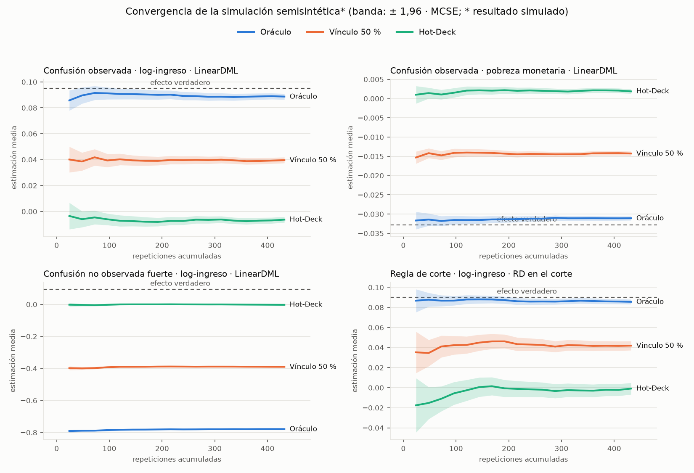

# Evaluación semisintética: recuperación de un efecto conocido sobre hogares reales

Generado 2026-11-03 por `src/validacion/simulacion_semisintetica.py`,
hoy el módulo `src/simulacion/` (mismo código, resultados idénticos;
`docs/metodologia/DISENO_MODULO_SIMULACION.md`).
**432 repeticiones hasta la convergencia** (Causal Forest en 216), encuesta
de 30.000 hogares por repetición. Salidas en `docs/reports/`:
`simulacion_semisintetica.txt` (consola), `_resumen.csv` (métricas con su
error Monte Carlo), `_convergencia.csv` (traza por lote), `_tablas.md` (las
tablas de abajo, generadas del resumen) y `simulacion_semisintetica.csv`
(cada repetición). Figura: `simulacion_semisintetica_convergencia.png`.

Es el componente central que pidió el tutor (2026-10-27) y que detalla la
revisión externa (§9). A diferencia de `SIMULACION_IDENTIFICACION.md`
(mundo 100 % sintético), **las covariables, la celda del Hot-Deck, el
ingreso y la línea de pobreza son los de los 290.968 hogares reales de
GEIH 2024**; solo se simulan el tratamiento y el efecto, así que la verdad
se conoce hogar por hogar.

## Diseño

```text
DATOS REALES     celda del Hot-Deck (993), X = {zona, sexo del jefe, paredes},
                 Y0 = log(1 + ingreso per cápita de la UG), línea de pobreza del dominio
GENERADOR        U = parte del ingreso que la celda y X no explican (real, no observable)
                 score = logit P_Sisbén(T | celda) + X·b + gamma·U
                 T ~ Bernoulli(score); en la regla de corte, T = 1(puntaje ≥ corte),
                 puntaje = score + ruido de medición
                 tau(X) = 0,10 + 0,05·rural − 0,03·jefa + 0,04·paredes precarias
                 Y = Y0 + tau(X)·T
OUTCOMES         log-ingreso (efecto +0,095) y pobreza monetaria (efecto −0,033)
ESCENARIOS       aleatoria / confusión observada / efecto nulo / confusión no
                 observada leve, media y fuerte (gamma 0,25, 0,5, 1) / solapamiento
                 débil (score × 4) / regla de corte (con gamma = 1)
INTEGRACIÓN      oráculo (T verdadero) / vínculo 50 % (la mitad recibe T y puntaje
                 de un donante) / Hot-Deck (todos, de un donante de su celda)
ESTIMADORES      diferencia de medias, regresión con efectos fijos de celda,
                 LinearDML y CausalForestDML (los de 5_estimacion.py, W = celda),
                 RD local lineal en el corte (solo en la regla de corte)
EVALUACIÓN       sesgo, RMSE, cobertura del IC 95 %, ancho, PEHE (error del CATE),
                 degradación por integración, y el MCSE de cada una
```

- P(T | celda) sale del Sisbén real; la tasa de tratados es la misma en
  todos los escenarios (46,7 %, calibrada).
- En cada repetición la población se parte en dos muestras **sin llave
  común**: la "encuesta" (X, Y) y el "registro" (X, T, puntaje), como GEIH
  y Sisbén. **El T verdadero de la encuesta solo se usa para medir.**
- La pobreza es 1 si el ingreso queda bajo la línea del dominio (DANE
  2024). Su efecto verdadero es la diferencia, hogar por hogar, entre ser
  pobre con y sin tratamiento: −0,033 (3,3 puntos menos de pobreza).
- La RD estima el efecto **en el corte**: su objetivo es el efecto medio
  de los hogares cercanos al corte (+0,090 en log-ingreso, −0,038 en
  pobreza), no el ATE.
- Para usarla con otra fuente (registros administrativos de una entidad)
  basta una tabla con las columnas de `COLUMNAS` en el script.

## Convergencia ("saciedad")

Las repeticiones corren en lotes de 24, en paralelo, hasta que **el error
estándar Monte Carlo (MCSE) de cada celda** (escenario × integración ×
outcome × estimador, 166 celdas) queda bajo el umbral (Morris, White y
Crowther, 2019, *Statistics in Medicine* 38:2074): MCSE del sesgo ≤ 0,003
en log-ingreso y ≤ 0,0015 en pobreza, y MCSE de la cobertura ≤ 0,025.
Mínimo 100 repeticiones, máximo 600.

| | Repeticiones | MCSE sesgo máx. | MCSE cobertura máx. | Celdas que cumplen |
|---|---|---|---|---|
| Todos los estimadores salvo Causal Forest | 432 | 0,0030 | 0,024 | 150 de 150 |
| Causal Forest (log-ingreso, oráculo y Hot-Deck) | 216 | 0,0039 | 0,033 | 10 de 16 |

Causal Forest se detuvo en su tope (200, alcanzado en el lote que llegó a
216) por costo: ≈45 s por repetición frente a ≈8 s del resto. Sus 6
celdas pendientes son coberturas con Hot-Deck (0,63-0,88), que
necesitarían ≈400 repeticiones, y el sesgo en dos escenarios donde ya es
enorme (solapamiento débil y regla de corte con oráculo). Ninguna cambia
una conclusión.



Desde ≈200 repeticiones las estimaciones medias no se mueven más que su
banda de error Monte Carlo: más repeticiones no cambiarían los resultados.

## Resultados

Media de la estimación en las repeticiones; entre paréntesis, la
cobertura del IC 95 % (debería ser ≈0,95).

#### log-ingreso

| Escenario | Efecto verdadero | Integración | Dif. de medias | Regresión EF celda | LinearDML | Causal Forest | RD en el corte |
|---|---|---|---|---|---|---|---|
| aleatoria | +0,095 | Oráculo | +0,095 (0,97) | +0,094 (0,96) | +0,094 (0,94) | +0,093 (1,00) | — |
|  | +0,095 | Vínculo 50 % | +0,048 (0,33) | +0,048 (0,30) | +0,047 (0,30) | — | — |
|  | +0,095 | Hot-Deck | +0,001 (0,00) | +0,001 (0,00) | +0,001 (0,00) | +0,002 (0,63) | — |
| confusion observada | +0,095 | Oráculo | -0,319 (0,00) | +0,090 (0,94) | +0,089 (0,91) | +0,090 (1,00) | — |
|  | +0,095 | Vínculo 50 % | -0,345 (0,00) | +0,046 (0,39) | +0,041 (0,34) | — | — |
|  | +0,095 | Hot-Deck | -0,371 (0,00) | +0,000 (0,00) | -0,006 (0,00) | -0,006 (0,72) | — |
| efecto nulo | +0,000 | Oráculo | -0,419 (0,00) | -0,002 (0,96) | -0,006 (0,92) | -0,006 (1,00) | — |
|  | +0,000 | Vínculo 50 % | -0,408 (0,00) | -0,000 (0,95) | -0,005 (0,91) | — | — |
|  | +0,000 | Hot-Deck | -0,398 (0,00) | +0,000 (0,95) | -0,006 (0,91) | -0,004 (1,00) | — |
| confusion no observada leve | +0,095 | Oráculo | -0,613 (0,00) | -0,291 (0,00) | -0,291 (0,00) | -0,293 (0,00) | — |
|  | +0,095 | Vínculo 50 % | -0,490 (0,00) | -0,145 (0,00) | -0,149 (0,00) | — | — |
|  | +0,095 | Hot-Deck | -0,369 (0,00) | -0,003 (0,00) | -0,008 (0,00) | -0,008 (0,75) | — |
| confusion no observada media | +0,095 | Oráculo | -0,796 (0,00) | -0,529 (0,00) | -0,527 (0,00) | -0,531 (0,00) | — |
|  | +0,095 | Vínculo 50 % | -0,578 (0,00) | -0,263 (0,00) | -0,264 (0,00) | — | — |
|  | +0,095 | Hot-Deck | -0,359 (0,00) | +0,001 (0,00) | -0,003 (0,01) | -0,002 (0,82) | — |
| confusion no observada | +0,095 | Oráculo | -0,981 (0,00) | -0,780 (0,00) | -0,778 (0,00) | -0,782 (0,00) | — |
|  | +0,095 | Vínculo 50 % | -0,658 (0,00) | -0,388 (0,00) | -0,387 (0,00) | — | — |
|  | +0,095 | Hot-Deck | -0,337 (0,00) | -0,001 (0,00) | -0,003 (0,01) | +0,000 (0,88) | — |
| solapamiento debil | +0,095 | Oráculo | -0,578 (0,00) | +0,064 (0,87) | +0,081 (0,92) | +0,075 (1,00) | — |
|  | +0,095 | Vínculo 50 % | -0,576 (0,00) | +0,032 (0,55) | +0,032 (0,58) | — | — |
|  | +0,095 | Hot-Deck | -0,575 (0,00) | +0,001 (0,20) | -0,008 (0,24) | -0,010 (1,00) | — |
| regla corte | +0,095 | Oráculo | -1,377 (0,00) | -1,708 (0,00) | -1,691 (0,00) | -1,708 (0,00) | +0,086 (0,94) |
|  | +0,095 | Vínculo 50 % | -0,938 (0,00) | -0,844 (0,00) | -0,816 (0,00) | — | +0,042 (0,83) |
|  | +0,095 | Hot-Deck | -0,502 (0,00) | +0,001 (0,08) | +0,003 (0,17) | -0,002 (0,99) | -0,001 (0,71) |

#### pobreza monetaria

| Escenario | Efecto verdadero | Integración | Dif. de medias | Regresión EF celda | LinearDML | RD en el corte |
|---|---|---|---|---|---|---|
| aleatoria | -0,033 | Oráculo | -0,033 (0,95) | -0,033 (0,96) | -0,033 (0,93) | — |
|  | -0,033 | Vínculo 50 % | -0,016 (0,12) | -0,016 (0,08) | -0,016 (0,09) | — |
|  | -0,033 | Hot-Deck | +0,000 (0,00) | -0,000 (0,00) | +0,000 (0,00) | — |
| confusion observada | -0,033 | Oráculo | +0,086 (0,00) | -0,031 (0,97) | -0,031 (0,92) | — |
|  | -0,033 | Vínculo 50 % | +0,097 (0,00) | -0,016 (0,13) | -0,015 (0,10) | — |
|  | -0,033 | Hot-Deck | +0,108 (0,00) | -0,000 (0,00) | +0,002 (0,00) | — |
| efecto nulo | +0,000 | Oráculo | +0,125 (0,00) | +0,000 (0,96) | +0,002 (0,92) | — |
|  | +0,000 | Vínculo 50 % | +0,123 (0,00) | +0,000 (0,94) | +0,002 (0,91) | — |
|  | +0,000 | Hot-Deck | +0,122 (0,00) | +0,000 (0,97) | +0,002 (0,91) | — |
| confusion no observada leve | -0,033 | Oráculo | +0,125 (0,00) | +0,021 (0,00) | +0,021 (0,00) | — |
|  | -0,033 | Vínculo 50 % | +0,116 (0,00) | +0,010 (0,00) | +0,012 (0,00) | — |
|  | -0,033 | Hot-Deck | +0,107 (0,00) | +0,000 (0,00) | +0,002 (0,00) | — |
| confusion no observada media | -0,033 | Oráculo | +0,160 (0,00) | +0,066 (0,00) | +0,066 (0,00) | — |
|  | -0,033 | Vínculo 50 % | +0,133 (0,00) | +0,032 (0,00) | +0,033 (0,00) | — |
|  | -0,033 | Hot-Deck | +0,106 (0,00) | -0,000 (0,00) | +0,001 (0,00) | — |
| confusion no observada | -0,033 | Oráculo | +0,214 (0,00) | +0,138 (0,00) | +0,138 (0,00) | — |
|  | -0,033 | Vínculo 50 % | +0,158 (0,00) | +0,069 (0,00) | +0,070 (0,00) | — |
|  | -0,033 | Hot-Deck | +0,102 (0,00) | +0,000 (0,00) | +0,002 (0,00) | — |
| solapamiento debil | -0,033 | Oráculo | +0,160 (0,00) | -0,023 (0,78) | -0,026 (0,87) | — |
|  | -0,033 | Vínculo 50 % | +0,162 (0,00) | -0,011 (0,27) | -0,010 (0,33) | — |
|  | -0,033 | Hot-Deck | +0,164 (0,00) | -0,000 (0,03) | +0,004 (0,02) | — |
| regla corte | -0,033 | Oráculo | +0,350 (0,00) | +0,398 (0,00) | +0,389 (0,00) | -0,034 (0,95) |
|  | -0,033 | Vínculo 50 % | +0,249 (0,00) | +0,197 (0,00) | +0,190 (0,00) | -0,016 (0,71) |
|  | -0,033 | Hot-Deck | +0,150 (0,00) | +0,000 (0,00) | +0,003 (0,00) | +0,001 (0,32) |

Efecto verdadero en el corte (objetivo de la RD): log-ingreso +0,090, pobreza monetaria -0,038

## Lectura

1. **Con Hot-Deck se pierde todo el efecto, sin excepción.** Regresión,
   DML, Causal Forest y RD devuelven ≈0 (−0,010 a +0,004) en los ocho
   escenarios y en los dos outcomes. El donante se sorteó dentro de la
   celda: su T no lleva información del hogar receptor. Es el mismo ≈0 de
   `5_estimacion.py` con datos reales, ahora con el efecto verdadero
   conocido: **ese ≈0 no dice nada sobre el efecto del Sisbén**.

2. **La pérdida es proporcional a los hogares mal vinculados.** Con la
   mitad de los hogares vinculados a un donante, la estimación cae a la
   mitad (0,041-0,048 en log-ingreso; −0,015 a −0,016 en pobreza). Regla
   práctica: sesgo ≈ −(fracción mal vinculada) × efecto. La concordancia
   del T imputado (50-83 % con Hot-Deck) no mide la calidad para estimar
   efectos, porque esos aciertos vienen de la celda, que es justo lo que
   se controla.

3. **Con el T verdadero, todo depende de si la confusión se observa.**
   Asignación aleatoria y confusión por la celda y X: regresión, DML y
   Causal Forest recuperan el efecto (0,089-0,094; −0,031 a −0,033 en
   pobreza). Solapamiento débil: siguen cerca, con menos cobertura
   (regresión 0,064, cobertura 0,87; DML 0,081, cobertura 0,92).

4. **Si la asignación depende de algo no observado, ningún estimador lo
   corrige, ni con el tratamiento verdadero**, y el sesgo crece con su
   fuerza: −0,29, −0,53 y −0,78 en log-ingreso (gamma 0,25, 0,5 y 1),
   cuando la verdad es +0,095. En pobreza el signo se invierte: +0,021,
   +0,066 y +0,138, es decir, "el programa aumenta la pobreza" cuando la
   reduce en 3,3 puntos. Es lo que expresan las cotas de Fréchet-Manski
   con datos reales: sin supuestos, el signo no está identificado.

5. **La discontinuidad en el corte es lo único que resiste la confusión
   no observada, pero necesita el vínculo hogar por hogar.** En la regla
   de corte con confusión fuerte, la regresión y el DML dan −1,7, y la RD
   con el T verdadero da +0,086 frente a +0,090 en el corte (cobertura
   0,94) y −0,034 frente a −0,038 en pobreza (0,95). Con vínculo del 50 %
   la RD cae a la mitad y con Hot-Deck a ≈0. Es el argumento para pedir el
   **puntaje continuo del Sisbén con una llave de hogar**.

6. **La diferencia de medias nunca sirve fuera de la asignación
   aleatoria** (−0,32 a −1,38): los tratados son más pobres por
   construcción. Con Hot-Deck y sin controlar la celda, además traslada la
   confusión entre celdas (−0,34 a −0,58): un efecto distinto de cero con
   Hot-Deck sin la celda es geografía y composición, no efecto.

7. **Efecto nulo (control del error tipo I).** La regresión con efectos
   fijos mantiene la cobertura nominal (0,94-0,97) con las tres
   integraciones; LinearDML queda algo por debajo (0,91-0,92) por el sesgo
   del punto 8.

8. **LinearDML tiene un sesgo pequeño pero real: −0,004 a −0,008 en
   log-ingreso** (≈5 % del efecto; z de −3 a −5 frente a su MCSE),
   también con efecto nulo y con Hot-Deck, donde la regresión con efectos
   fijos exactos da ≈0. En pobreza es +0,002. **Causa verificada en la
   sensibilidad (sección siguiente):** la regularización de los modelos
   auxiliares (Ridge alpha = 1 y logística C = 10 sobre 993 indicadoras
   de celda) encoge los efectos de celda y deja confusión entre celdas.
   Casi sin regularizar, el sesgo con efecto nulo baja de −0,006 a
   −0,002 y deja de distinguirse de cero.

9. **Causal Forest no recupera la heterogeneidad.** Su error del CATE
   (PEHE 0,052-0,068 con oráculo sin confusión no observada) es mayor que
   la variación real del efecto entre hogares (desviación de tau = 0,028):
   predecir el mismo efecto para todos daría menos error. Su IC del ATE es
   2,6 a 5 veces más ancho que el del DML (0,20-0,78 frente a 0,08-0,16),
   y por eso "cubre" aun cuando estima ≈0 con Hot-Deck (0,63-0,88): es
   conservador, no más acertado.

10. **Con confusión no observada la "degradación" por integración sale
    negativa** (el Hot-Deck tiene menor RMSE que el oráculo). No es una
    mejora: el Hot-Deck lleva cualquier estimación a ≈0, y 0 queda más
    cerca de +0,095 que el −0,78 del oráculo confundido.

## Sensibilidad (2026-11-04)

`src/validacion/sensibilidad_semisintetica.py`, mismo generador y mismos
hogares, solo log-ingreso. 228 repeticiones, hasta que el MCSE del sesgo
quedó bajo 0,003 en cada celda (0,008 en la RD). Salidas:
`docs/reports/sensibilidad_semisintetica{.txt,_resumen.csv,.csv}`.

**1. Tamaño del efecto: la pérdida es proporcional.** Regresión con
efectos fijos de celda, confusión observada:

| Efecto verdadero | Oráculo | Vínculo 50 % | Hot-Deck |
|---|---|---|---|
| 0,047 (× 0,5) | 0,044 | 0,021 (44 %) | −0,001 |
| 0,095 (× 1) | 0,089 | 0,043 (45 %) | −0,001 |
| 0,190 (× 2) | 0,183 | 0,093 (49 %) | 0,000 |

Con Hot-Deck se pierde todo el efecto, sea del tamaño que sea; con
vínculo del 50 %, algo menos de la mitad. La RD en la regla de corte se
comporta igual (Hot-Deck −0,003 a +0,004 con efectos de 0,045 a 0,181 en
el corte).

**2. Regla de corte difusa.** Participa el 80 % de los elegibles y el 20 %
de los no elegibles. La RD difusa (dos etapas local: salto en Y / salto
en la participación) recupera el efecto en el corte con el tratamiento
vinculado: **0,086 frente a 0,090, cobertura 0,96**; la regresión y el
DML dan −0,55. Con vínculo del 50 %, 0,044; con Hot-Deck, 0,007 (≈0).
La RD sirve aunque no todos los elegibles reciban el programa, pero
sigue necesitando el vínculo hogar por hogar.

**3. Causa del sesgo de LinearDML.** Mismos datos, LinearDML con la
regularización del proyecto y casi sin regularizar (alpha = 1e-6,
C = 1e6):

| Efecto nulo | Regresión EF | LinearDML (proyecto) | LinearDML sin regularizar |
|---|---|---|---|
| Oráculo | −0,002 (z −1,4) | −0,006 (z −3,7) | −0,002 (z −1,3) |
| Vínculo 50 % | −0,000 (z −0,3) | −0,006 (z −3,4) | −0,002 (z −1,1) |
| Hot-Deck | −0,000 (z −0,2) | −0,007 (z −4,5) | −0,003 (z −1,9) |

La regularización explica el sesgo propio del DML: sin ella cae a la
mitad o menos y deja de ser significativo. Con confusión observada y
efecto distinto de cero queda además un sesgo común a la regresión y al
DML sin regularizar (−0,004 a −0,006 con el efecto de base) que crece
con el efecto (−0,0035, −0,006 y −0,007 con × 0,5, × 1 y × 2): es la
ponderación desigual de un efecto heterogéneo por la varianza del
tratamiento, no confusión. **Pendiente de decisión:** bajar la
regularización en `5_estimacion.py` (cambiaría los ATE de datos reales en
milésimas; hoy son un placebo ≈0).

## Qué significa para la tesis

- **Con las fuentes actuales (Hot-Deck), ningún estimador puede
  recuperar el efecto del Sisbén.** Lo que se puede reportar son cotas
  (Fréchet-Manski) y el placebo del emparejamiento; la simulación lo
  demuestra con hogares reales, efecto conocido, cinco estimadores y ocho
  escenarios.
- **Para recuperar el efecto hacen falta dos cosas a la vez:** vincular
  hogar por hogar (llave común) y un diseño que resista la confusión no
  observada (RD con el puntaje continuo). Con vínculo parcial, el efecto
  se atenúa en proporción a los hogares mal vinculados.
- **Para una entidad que integre sus propios registros:** medir la
  fracción de hogares bien vinculados antes de estimar; la concordancia
  del tratamiento imputado no sirve como indicador.

## Limitaciones

- Efecto aditivo en log-ingreso; el de pobreza se deriva de él.
- U se construye con el residuo del propio ingreso: realista en forma,
  pero su fuerza (gamma) es un supuesto; por eso tres niveles.
- Sin ajuste por diseño muestral. T sigue una logística de la celda y de
  tres variables de X; la regla de corte es nítida (cumplimiento
  perfecto), no difusa.
- Las cifras de este documento se generaron con el Hot-Deck simulado
  sin la cadena de respaldos del pipeline: el hogar sin donantes en su
  celda recibía uno de todo el registro. Desde el 2026-11-04 el código usa
  la cadena (celda → sin pisos → depto + edad → depto); con los datos
  reales cambia el 0,03 % de la encuesta (en 5 repeticiones: 277 hogares
  sin pisos, 74 depto + edad, 10 depto, ninguno en todo el registro). Las
  cifras se regeneran con la próxima corrida (junto con el asterisco).
- Causal Forest en 216 repeticiones (6 de sus 16 celdas sobre el umbral
  de MCSE, ver Convergencia).

## Para reproducir

```bash
PYTHONIOENCODING=utf-8 ./.venv/Scripts/python.exe -m src.simulacion 3 > docs/reports/simulacion_semisintetica.txt 2>&1
poetry run pytest tests/test_simulacion_semisintetica.py tests/test_simulacion_contrato.py tests/test_simulacion_equivalencia.py
```

El argumento es el número de procesos en paralelo. Con el equipo libre
tarda ≈1,5 horas (lotes de 24 repeticiones: ≈12 min con Causal Forest y
≈3,5 min sin él); esta corrida tomó 4 horas porque el equipo estuvo
ocupado. Si se interrumpe, al volver a correrla retoma desde el último
lote guardado (mientras no cambie la configuración). Requiere
`muestra_estimacion_monetaria_2024.parquet` y el Sisbén estandarizado.
